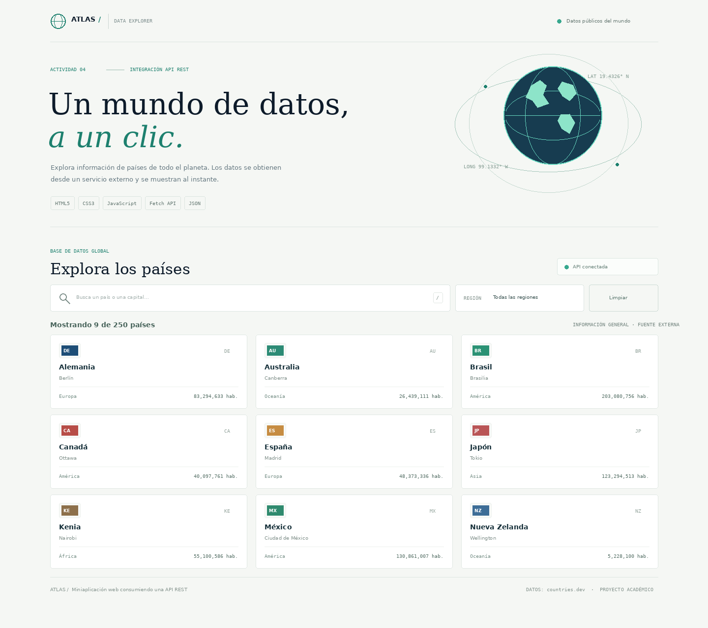

# Atlas — Explorador de países 🌎

Miniaplicación web desarrollada para la **Actividad 4: Miniaplicación Web consumiendo una API REST**. Consulta información pública de países desde un servicio externo y permite explorarla mediante búsqueda y filtro por región.

## Demo y repositorio

- **Aplicación publicada:** agrega aquí la URL de GitHub Pages cuando completes el despliegue.
- **Repositorio:** agrega aquí la URL de tu repositorio de GitHub.

## API utilizada

- **Servicio:** [countries.dev](https://countries.dev/)
- **Documentación general:** https://countries.dev/docs
- **Documentación del endpoint:** https://countries.dev/docs/api/countries
- **Método HTTP:** `GET`
- **Endpoint utilizado:**

```text
https://countries.dev/countries?fields=name,capital,region,population,flag,alpha2Code
```

La API entrega una lista JSON de países. El parámetro `fields` limita la respuesta a los campos que utiliza la interfaz:

| Campo | Uso en la aplicación |
|---|---|
| `name` | Nombre del país |
| `capital` | Capital |
| `region` | Región geográfica |
| `population` | Población |
| `flag` | URL o símbolo de la bandera |
| `alpha2Code` | Código de país de dos letras |

**Autenticación:** no requiere API key ni registro. La documentación declara soporte CORS para solicitudes desde el navegador.

### Formato de respuesta

La respuesta exitosa es un arreglo JSON de objetos. Ejemplo ilustrativo reducido:

```json
[
  {
    "name": "Mexico",
    "capital": "Mexico City",
    "region": "Americas",
    "population": 128455567,
    "flag": "https://countries.dev/flags/mx.svg",
    "alpha2Code": "MX"
  }
]
```

Los valores exactos pueden cambiar conforme se actualiza la fuente de datos.

### Códigos y manejo de errores

| Código HTTP | Significado documentado | Respuesta de la aplicación |
|---|---|---|
| `200` | Solicitud correcta | Procesa el JSON y presenta las tarjetas |
| `400` | Parámetro incorrecto | Muestra un mensaje para revisar la solicitud |
| `404` | Recurso no encontrado | Informa que el recurso no está disponible |
| `429` | Límite temporal de solicitudes | Sugiere esperar y reintentar |
| `5xx` | Error del servidor (manejo general) | Muestra un mensaje de indisponibilidad temporal |
| Sin respuesta / CORS / red | No se pudo completar `fetch()` | Indica que se revise la conexión y permite reintentar |

La aplicación comprueba `response.ok` antes de procesar los datos. También valida que la respuesta sea un arreglo y contempla campos opcionales como capital, población y bandera.

## Funcionalidades

- Consulta inicial de países con `fetch()`, `async` y `await`.
- Procesamiento de la respuesta con `response.json()`.
- Creación dinámica de tarjetas mediante `document.createElement()` y `DocumentFragment`.
- Búsqueda por nombre, capital o código de país.
- Filtro por región geográfica.
- Contador de resultados y botón para limpiar filtros.
- Estados de carga, resultado vacío, error y reintento.
- Diseño adaptable a computadora, tableta y teléfono.
- Acceso rápido a la búsqueda con la tecla `/`.

## Tecnologías

- HTML5 semántico.
- CSS3 (Grid, Flexbox, variables y media queries).
- JavaScript ES6+.
- Fetch API, Promises, `async/await` y JSON.
- Git y GitHub Pages para control de versiones y publicación.

## Instrucciones de uso

### Ejecutar localmente

1. Descarga o clona este repositorio.
2. Abre la carpeta del proyecto.
3. Ejecuta `index.html` con un servidor local. En Visual Studio Code puedes usar la extensión **Live Server**; también puedes ejecutar `python -m http.server 8000` desde la carpeta.
4. Abre `http://localhost:8000` en el navegador.
5. Espera a que aparezca el indicador **API conectada**. Es necesaria una conexión a internet para consultar countries.dev.
6. Escribe un país o capital en el campo de búsqueda, o selecciona una región. Usa **Limpiar** para restablecer los filtros.

### Publicar con GitHub Pages

1. Crea un repositorio público en GitHub, por ejemplo `actividad4-api-paises`.
2. Sube `index.html`, `styles.css`, `app.js`, `README.md` y la carpeta `assets`.
3. En el repositorio abre **Settings → Pages**.
4. En **Build and deployment**, selecciona **Deploy from a branch**.
5. Selecciona la rama `main` y la carpeta `/ (root)`; guarda los cambios.
6. Espera a que GitHub Pages muestre la URL y abre el sitio para verificar la carga de países, búsqueda, filtro y mensajes de error.
7. Actualiza la sección **Demo y repositorio** de este README con los dos enlaces definitivos.

## Commits sugeridos

```bash
git add .
git commit -m "feat: crear interfaz del explorador de países"
git add app.js
git commit -m "feat: consumir API de países con fetch y async await"
git add README.md assets/
git commit -m "docs: documentar API, uso y capturas del proyecto"
git push origin main
```

Si subes los archivos directamente desde la página web de GitHub, escribe mensajes descriptivos en el campo **Commit changes** al guardar cada grupo de archivos.

## Captura de pantalla

La carpeta `assets/` contiene una captura de vista previa de la interfaz con datos de demostración. Después de publicar la aplicación, se recomienda reemplazarla por una captura tomada desde la URL pública con los datos reales de la API.



## Reflexión técnica

Esta actividad permitió comprender cómo una aplicación web puede obtener información de un servicio externo sin capturarla manualmente. Con `fetch()` y `async/await` se separó la consulta de red del procesamiento de los datos, mientras que JSON facilitó acceder a los atributos de cada país. La creación dinámica de elementos del DOM hizo posible representar los resultados sin escribir una tarjeta fija por cada registro. Además, la búsqueda y el filtro muestran cómo los datos recibidos pueden transformarse en una experiencia interactiva. Finalmente, el manejo de carga, resultados vacíos y errores mejora la comunicación con el usuario, ya que una petición a una API puede fallar por conectividad, parámetros o disponibilidad del servicio.

## Fuentes

- countries.dev. (s. f.). *Quick Start*. https://countries.dev/docs
- countries.dev. (s. f.). *List all countries*. https://countries.dev/docs/api/countries
- countries.dev. (s. f.). *Response format*. https://countries.dev/docs/response-format
- countries.dev. (s. f.). *Errors & status codes*. https://countries.dev/docs/errors